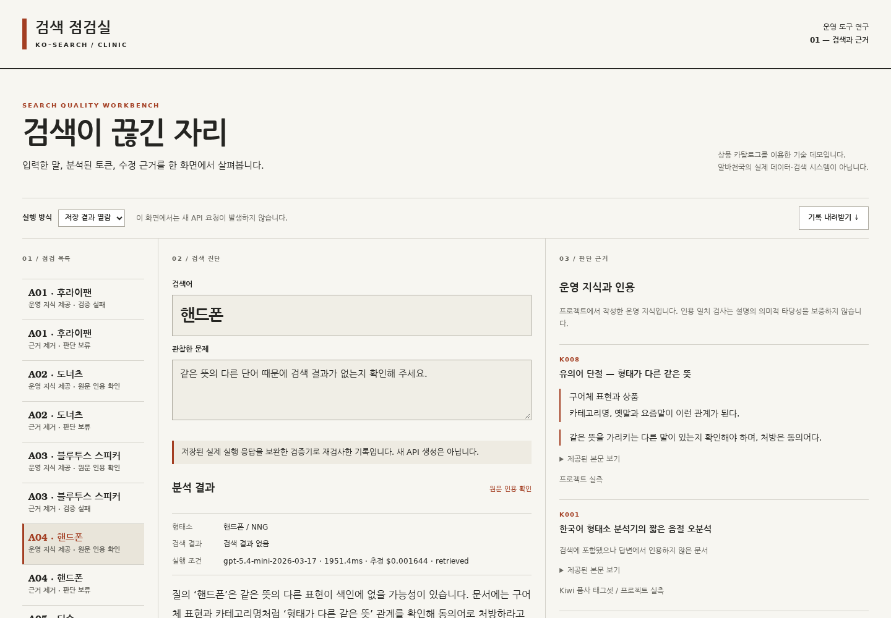

# ko-search-clinic

한국어 검색 실패를 분석하고, 운영 지식을 근거로 수정안을 검증하는 Python 서비스입니다.

`도너츠`와 `도넛`처럼 표현이 달라 검색이 끊기는 문제를 다룹니다. LLM이 만든 설명·원문 인용·수정 후보를 분리하고, 후보가 전체 평가셋 검사를 통과해야 별도 세션에 적용합니다.

**자료 범위:** 작성한 상품 카탈로그 72건, 평가셋 36질의(건강 20 + 실패 16). 실제 채용 공고나 알바천국 고객 데이터가 아닙니다.

## 실행

Python 3.11 또는 3.12 환경에서:

```bash
pip install -e '.[api]'
python -m searchclinic.api.explanation_api
```

[http://127.0.0.1:8000/demo/](http://127.0.0.1:8000/demo/)에서 **저장 결과 열람**을 선택합니다. API 키 없이 실제 모델 응답을 보완한 검증기로 재검사한 기록 24건을 확인할 수 있습니다. 새 생성·새 과금은 없습니다.

실제 생성은 [운영 설정](docs/alba-operation.md)의 별도 활성화가 필요합니다. 공개 정적 화면에 API 키를 넣지 않습니다.

## 기능

- 질의·형태소·검색 결과를 함께 확인하는 점검 화면
- BM25로 찾은 운영 지식 3개를 이용한 GPT 설명·실패 유형·수정 후보 생성
- 문서 ID와 본문 인용 대조, 형식 차이의 원문 위치 복원
- Pydantic 스키마 및 동의어·사용자 사전·복합어 규칙 검증
- 기존 36개 질의 회귀 검사와 별도 세션 적용
- 생성 실패·근거 부족·검증 차단·회귀 기각을 구분하는 화면과 지표
- 요청 전 비용 예약, 자동 재시도 없음, 서버 토큰, 모바일·취소·JSON 내보내기

## 검증 결과

실제 OpenAI API **24회**, 응답 24회, 추정 비용 **$0.02903175**. 최초 검증에서는 12건이 차단됐습니다. 원본 응답을 보존하고 줄바꿈·강조 표시 처리만 보완해 같은 응답을 추가 API 호출 없이 재검증했습니다.

| 저장 응답 재검증 24건 | 결과 |
|---|---:|
| 형식·인용 조건 통과, 수정 후보 있음 | 6 |
| 판단 보류 | 12 |
| 형식·인용·상태 문제로 차단 | 6 |
| 후보 6건의 회귀 검사 | 채택 4 / 기각 2 |

후처리 보완 후 같은 자료를 다시 검사한 결과이며, 독립 평가에서 모델 정확도가 개선됐다는 뜻이 아닙니다. 채택된 4개 후보는 각각 새 세션에서 평가했으며 실제 고객 효과는 확인하지 않았습니다.

[사전 계획·원시 응답·전후 판정·한계](docs/verification/alba-20261027/README.md) · [실제 API 실행](https://github.com/sokldjs554/ko-search-clinic/actions/runs/40463356460) · [PR #2](https://github.com/sokldjs554/ko-search-clinic/pull/2)

## 화면



캡처는 실제 저장 응답을 재검증한 화면입니다. 브라우저의 새 생성 버튼·취소·오류 전환은 별도 테스트 응답으로 검사했습니다.

## 테스트

```bash
pip install -e '.[api,mcp,dev]'
python -m pytest -q
clinic baseline
python scripts/revalidate_alba.py  # 저장 응답 재검사, API 키 불필요
```

브라우저 검사: Playwright 설치 후 `node scripts/browser_alba.cjs`. 전체 결과와 환경은 날짜별 검증 기록에 남깁니다. Kiwi 0.24.1, 모델 0.24.0, cong-global을 고정합니다.

## 설계와 근거

- [서비스 구조와 운영 설정](docs/alba-operation.md)
- [공고 항목별 근거와 미확인 범위](docs/alba-job-audit.md)
- [설계·재구현 범위](docs/superpowers/specs/2026-10-27-alba-rag-design.md)
- [기존 검색·임베딩·Elasticsearch 실험 보존 문서](README-legacy.md)

실제 모델 학습, LangChain·LlamaIndex 도입, 채용 검색 고객 실증, 공개 과금 API 운영을 수행한 프로젝트로 소개하지 않습니다. 이번 RAG 서비스는 직접 작성한 검색·검증 모듈과 OpenAI Responses API를 사용합니다.
