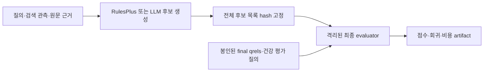

# Phase 2 좁힌 계획 — 아직 실행하지 않음

범위는 독립 평가 질의 구성과 규칙/실제 LLM의 동일 조건 비교다. UI, 서비스,
새 retriever, answer generation, 범용 Agent 프레임워크는 추가하지 않는다.
현재 controlled-v1/dev 결과는 개발 결과로 보존하고 독립 test와 합산하지 않는다.

## 독립 데이터와 고정 순서

1. 개발 데이터는 기존 v1 및 별도의 dev 파일로 유지한다. 신규 최종 test는
   원래 실패 질의의 단순 문자열 치환이 아닌 독립적인 질의·개념·문서 그룹에서
   구성한다. 목표 표본은 healthy 60 + failing 60이다. 이는 계획이며 수집된
   데이터나 실험 분모가 아니다.
2. 문서·정규화 질의·템플릿·동의어 그룹 연결 성분을 split 전체에 걸쳐 검사한다.
   corpus 내용은 검색 입력으로 사용할 수 있으나 qrels와 family 정답은 별도
   evaluator 전용 저장소/프로세스에 둔다. 원문 재배포 권리도 수집 시 확인한다.
3. qrels를 생성한 담당자가 독립적으로 검수하고 평가 경계와 hash를 고정한다.
   candidate 생성기가 qrels module이나 evaluator 메모리를 import할 수 없게
   프로세스/API 경계를 둔다. dev에서만 threshold·정책·prompt를 확정한다.
4. test를 실행하기 전에 split hash, detector/policy/prompt/model 버전, 행동
   예산, 비용 상한, 성공/기각 기준과 그룹 bootstrap 방법을 사전 등록한다.

## 최종 정답을 사용하는 경계

규칙과 LLM 모두 동일한 label-free query/관측/top-k 결과/원문 evidence span
입력만 받는다. family, expected patch kinds, qrels, baseline nDCG/recall,
전체 건강 test 질의 목록을 후보 생성기에 주지 않는다.

최종 test에서는 각 질의에 대한 후보 목록을 먼저 전부 생성·hash 고정한다.
후보 생성이 끝난 뒤 격리된 evaluator가 qrels로 점수와 회귀를 계산한다.
test의 채택/기각, 표적 점수, 회귀 질의·지표를 후보 생성기에 반환하지 않는다.
한 질의의 test 판정이 다음 질의의 prompt나 후보 목록에 영향을 주지 않는다.
test scoring을 보고 후보를 다시 생성하거나 prompt/threshold를 수정하지 않는다.

현재 GateAdapter는 v1 평가셋을 강제한다. 독립 데이터용 evaluator 인터페이스와
위 프로세스 경계는 Phase 2에서 별도 설계·테스트하며 이번 작업에서 구현하지 않는다.

실제 gate 피드백을 통한 적응 실험은 dev/reference regression 집합에서만
별도 실행한다. final test qrels를 반복 채택 피드백으로 사용하는 경로는
허용하지 않는다. final test의 gate 판정은 사후 평가/진단값이며 배포 시
정답 없이 자동 채택할 수 있다는 증거로 취급하지 않는다.

## 동일 조건 비교

- RulesPlus 후보 생성과 실제 LLM 한 번의 구조화 호출을 비교한다.
- 각 arm에 같은 관측과 원문 근거, 같은 typed patch schema, 같은 후보 최대
  3개/동일 제출 예산을 준다. LLM은 하나의 호출에서 순서가 있는 후보 목록을
  생성한다. evaluator는 둘의 고정 후보 목록을 같은 gate·같은 순서 규칙으로
  평가한다. 사람이 결과를 보고 후보를 수정하지 않는다.
- 후보 생성 시간/모델 호출/usage와 실제 검색·gate 비용을 분리한다. 추정
  행동 비용을 쓰면 dev에서 먼저 고정하고 실측 비용을 선택 입력으로 되돌리지 않는다.
- 현재 아답터 결과는 RulesPlus 사다리의 순차 재시도다. 위 one-shot 목록
  비교도 LLM의 피드백 이해/자가 수정 실험이라고 부르지 않는다.
- no repair를 참고값으로 두고 같은 고정 detector/policy 아래 RulesPlus와
  LLM selective 두 arm만 비교한다. 실제 생성 비용을 각각 기록한다. 별도
  always LLM arm은 이번 좁힌 계획에 포함하지 않는다. 이를 추가하려면 호출
  예산을 새로 제시한다. 탐지 오류, 건강 진단·제출·채택, 실패 복구, 모든
  회귀와 실패를 같은 분모로 보고한다.
- 독립 group 단위 신뢰구간을 사용한다. 표본이 부족하면 일반화·우위 판정을
  보류하고 부정적 결과를 그대로 기록한다.

## 유료 API 제안 — 승인 전 실행 금지

- 제안 모델: `gpt-4.1-mini-2025-04-14` snapshot. 승인 시 제공 여부와 공식
  가격을 재확인하며 다른 모델로 자동 대체하지 않는다.
- 계획 호출: dev 점검 최대 12회 + 최종 test 최대 120회 = 상한 132회.
  고정 detector가 no_op로 결정한 질의는 두 arm 모두 후보 생성/모델 호출을
  생략하므로 실제 호출은 이 상한보다 적을 수 있다. test 질의별 provider
  호출은 최대 1회, 자동 retry는 0이다. 이것은 실행된 호출 수가 아니다.
- 호출 상한: 입력 6000 tokens, 출력 1500 tokens. prompt가 입력 상한을 넘으면
  호출 전에 중단한다. usage를 받은 뒤 실제 input/output과 비용을 기록한다.
- 최대 API 예산: USD 5.00. 실행 전 공식 단가로 각 호출의 최대 비용을 계산하고
  미지 단가·누락 usage·누적 상한 초과·모델 변경이면 fail-closed로 중단한다.
  호출 전 최대 가능 금액을 예산에서 예약하여 마지막 호출도 상한을 넘지 않는다.
- 승인 전에는 키 연결, 유료 호출, test 실행을 하지 않는다. API 실패도 실행
  결과로 기록하고 반복 재시도하거나 성공 질의만 골라 재평가하지 않는다.

데이터 수집과 위 경계/예산을 검토한 뒤 별도 구현 계획을 작성한다.
